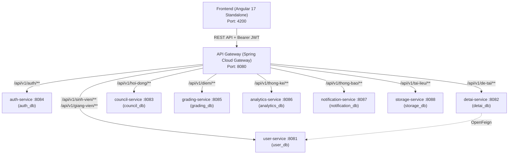

# Hệ Thống Quản Lý Đồ Án Tốt Nghiệp (Microservices - SOA)

Hệ thống quản lý đồ án tốt nghiệp xây dựng theo kiến trúc Microservices gồm **09 services Backend** (Java 21 / Spring Boot 3) và **Frontend** (Angular 17 Standalone Components), áp dụng mô hình Monorepo.

---

## 1. Kiến Trúc Tổng Quan



* **Mô hình Database-per-Service:** Mỗi service sở hữu 1 database riêng trên MySQL 8.0 (tổng cộng 8 DB).
* **Giao tiếp ngoại vi:** Toàn bộ request từ Frontend chỉ đi qua API Gateway cổng `8080`.
* **Giao tiếp nội bộ:** `detai-service` gọi `user-service` qua OpenFeign để kiểm tra thông tin sinh viên khi đăng ký đề tài.

---

## 2. Cấu Trúc Thư Mục

```text
SOA/
├── backend/
│   ├── api-gateway/          # Port 8080 - Cổng định tuyến API, xử lý CORS
│   ├── auth-service/         # Port 8084 - Đăng nhập, cấp và kiểm tra JWT
│   ├── user-service/         # Port 8081 - Quản lý Sinh viên, Giảng viên, Khoa, Lớp
│   ├── detai-service/        # Port 8082 - Quản lý và đăng ký đề tài (có Cache)
│   ├── council-service/      # Port 8083 - Quản lý Hội đồng bảo vệ, phân công đề tài
│   ├── grading-service/      # Port 8085 - Quản lý điểm, tính ĐTB, xếp loại
│   ├── analytics-service/    # Port 8086 - Thống kê số liệu, xuất file CSV (có Cache)
│   ├── notification-service/ # Port 8087 - Gửi và quản lý thông báo
│   ├── storage-service/      # Port 8088 - Upload và tải file tài liệu, đồ án
│   └── pom.xml               # Parent POM quản lý dependency tập trung
├── frontend/                 # Client Angular 17 Standalone
│   ├── src/
│   │   ├── app/
│   │   │   ├── core/         # Interceptors (gắn JWT token), Guards, Services toàn cục
│   │   │   ├── features/     # Module theo chức năng (auth, de-tai, user, hoi-dong, cham-diem, thong-ke, tai-lieu)
│   │   │   ├── shared/       # Components và Models dùng chung
│   │   │   ├── app.ts        # Root Component (standalone: true)
│   │   │   └── app.routes.ts # Cấu hình Routing
│   │   ├── environments/     # Cấu hình API URL (trỏ về Gateway 8080)
│   │   └── main.ts           # Entry point (bootstrapApplication)
├── docker-compose.yml        # Chạy toàn bộ 9 services + MySQL 8.0
├── init.sql                  # Tạo 8 database và nạp dữ liệu mẫu
└── pom.xml                   # Root POM
```

---

## 3. Danh Sách 09 Microservices Backend

Tất cả service viết bằng **Java thuần (không dùng Lombok)**, cấu trúc chuẩn:  
`Controller -> service/interfaces/I<Name>Service -> service/<Name>Service (bỏ chữ Impl) -> Repository -> DTO -> ApiResponse<T>`.

| Service | Port | Database | Chức Năng Chính |
| :--- | :---: | :--- | :--- |
| **api-gateway** | 8080 | — | Cổng định tuyến API tập trung, xử lý CORS |
| **auth-service** | 8084 | auth_db | Đăng nhập, cấp và xác thực token JWT, mã hóa mật khẩu BCrypt |
| **user-service** | 8081 | user_db | Quản lý sinh viên, giảng viên, khoa, lớp |
| **detai-service** | 8082 | detai_db | Quản lý đề tài, sinh viên đăng ký đề tài (có Cache) |
| **council-service** | 8083 | council_db | Lập hội đồng bảo vệ, phân công đề tài cho hội đồng |
| **grading-service** | 8085 | grading_db | Nhập điểm, tính điểm trung bình, xếp loại |
| **analytics-service** | 8086 | analytics_db | Thống kê số lượng đề tài, tỷ lệ đạt, xuất CSV (có Cache) |
| **notification-service** | 8087 | notification_db | Gửi thông báo phê duyệt, nhắc hạn |
| **storage-service** | 8088 | storage_db | Upload và tải file tài liệu đồ án (.pdf, .docx, .zip) |

---

## 4. Cấu Trúc Frontend (Angular 17 Standalone)

Xây dựng theo chuẩn Angular 17 không dùng `NgModule`:
* **Standalone Component:** Toàn bộ component đều dùng `standalone: true`.
* **Khởi động (`main.ts`):** Dùng `bootstrapApplication(AppComponent, { providers: [ provideHttpClient(withInterceptors([authInterceptor])), provideRouter(routes) ] })`.
* **Cấu trúc thư mục:**
  * `core/`: Chứa `auth.interceptor.ts` (tự động gắn token vào header request và chuyển về `/login` nếu nhận mã 401), guards, services dùng chung toàn app.
  * `features/`: Chia theo từng nghiệp vụ độc lập (`auth`, `de-tai`, `user`, `hoi-dong`, `cham-diem`, `thong-ke`, `tai-lieu`), mỗi feature có component và service gọi API riêng.
  * `shared/`: Chứa model và UI component tái sử dụng (navbar, dialog, toast).
  * `environments/`: File `environment.ts` chứa `apiUrl: 'http://localhost:8080/api/v1'`.

---

## 5. Hướng Dẫn Chạy Dự Án

### Yêu Cầu Môi Trường:
* Docker & Docker Compose (hoặc JDK 21 + Maven cho Backend, Node.js 18+ cho Frontend).

### 5.1. Chạy Backend bằng Docker Compose
```bash
cd /home/vodailoc/SOA
docker compose up -d --build
```
Kiểm tra trạng thái: `docker compose ps`. Gateway chạy tại `http://localhost:8080`.

### 5.2. Chạy Backend thủ công (Maven)
```bash
mvn clean test-compile -DskipTests
# Chạy từng service:
cd backend/api-gateway && mvn spring-boot:run
```

### 5.3. Chạy Frontend (Angular)
```bash
cd /home/vodailoc/SOA/frontend
npm install
npm start
```
Truy cập: `http://localhost:4200`.

---

## 6. Các API Endpoints Chính (Qua Gateway :8080)

| Chức Năng | Method | Endpoint | Service Xử Lý |
| :--- | :---: | :--- | :---: |
| Đăng nhập | `POST` | `/api/v1/auth/login` | `auth-service:8084` |
| Danh sách sinh viên | `GET` | `/api/v1/sinh-vien` | `user-service:8081` |
| Danh sách giảng viên | `GET` | `/api/v1/giang-vien` | `user-service:8081` |
| Danh sách đề tài (có Cache) | `GET` | `/api/v1/de-tai` | `detai-service:8082` |
| Tạo đề tài (xóa Cache) | `POST` | `/api/v1/de-tai` | `detai-service:8082` |
| Đăng ký đề tài | `POST` | `/api/v1/de-tai/dang-ky` | `detai-service:8082` |
| Duyệt đề tài | `PUT` | `/api/v1/de-tai/{id}/duyet` | `detai-service:8082` |
| Tạo hội đồng | `POST` | `/api/v1/hoi-dong` | `council-service:8083` |
| Phân công hội đồng | `POST` | `/api/v1/hoi-dong/phan-cong` | `council-service:8083` |
| Nhập điểm | `POST` | `/api/v1/diem` | `grading-service:8085` |
| Xem ĐTB & Xếp loại | `GET` | `/api/v1/diem/trung-binh/{maDeTai}` | `grading-service:8085` |
| Báo cáo thống kê (có Cache) | `GET` | `/api/v1/thong-ke/detai` | `analytics-service:8086` |
| Xuất thống kê CSV | `GET` | `/api/v1/thong-ke/xuat?dinhDang=excel` | `analytics-service:8086` |
| Upload tài liệu | `POST` | `/api/v1/tai-lieu/upload` | `storage-service:8088` |
| Tải tài liệu | `GET` | `/api/v1/tai-lieu/{id}/tai-ve` | `storage-service:8088` |
