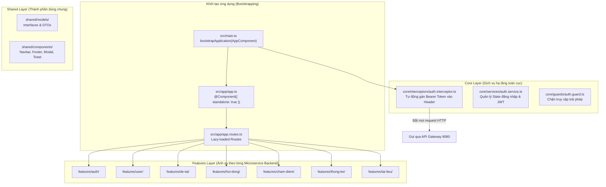

# HỆ THỐNG QUẢN LÝ ĐỒ ÁN TỐT NGHIỆP — KIẾN TRÚC MICROSERVICES (SOA)

Hệ thống được thiết kế và triển khai theo mô hình **Service-Oriented Architecture (SOA) / Microservices**, tổ chức theo cấu trúc **Monorepo** độc lập giữa `backend/` và `frontend/`. Toàn bộ hệ thống tuân thủ nguyên tắc **Database-per-Service**, giao tiếp phi tập trung qua **API Gateway**, mã hóa phân quyền bằng **Stateless JWT**, và tối ưu hiệu năng bằng **Spring In-Memory Caching**.

---

## 1. TỔNG QUAN KIẾN TRÚC HỆ THỐNG (SYSTEM ARCHITECTURE)

Hệ thống áp dụng mô hình phân lớp chuẩn doanh nghiệp:
* **Client Layer:** Ứng dụng Single Page Application (SPA) phát triển trên nền tảng **Angular 17 Standalone Components**.
* **API Gateway Layer:** Điểm đón duy nhất cho toàn bộ traffic ngoại vi, chịu trách nhiệm Reverse Proxy, Routing, Global CORS và cân bằng tải.
* **Microservices Layer:** 08 dịch vụ nghiệp vụ độc lập, tự chủ hoàn toàn về logic nghiệp vụ và dữ liệu.
* **Persistence Layer:** Hệ quản trị CSDL quan hệ MySQL 8.0 với 08 Database Schema riêng biệt.

```mermaid
flowchart TD
    subgraph Frontend_Layer["Frontend Layer (Client)"]
        FE["Angular 17 SPA (Standalone Components)\nPort: 4200"]
    end

    subgraph Gateway_Layer["API Gateway Layer (Reverse Proxy & Security Boundary)"]
        GW["API Gateway (Spring Cloud Gateway WebFlux)\nPort: 8080"]
    end

    subgraph Backend_Services["Backend Microservices Layer (Business Logic)"]
        AUTH["auth-service\nPort: 8084 | JWT & BCrypt"]
        USER["user-service\nPort: 8081 | SinhVien, GiangVien"]
        DETAI["detai-service\nPort: 8082 | Spring Cache + OpenFeign"]
        COUNCIL["council-service\nPort: 8083 | Hội đồng bảo vệ"]
        GRADING["grading-service\nPort: 8085 | Chấm điểm & Xếp loại"]
        ANALYTICS["analytics-service\nPort: 8086 | Spring Cache & Báo cáo"]
        NOTIF["notification-service\nPort: 8087 | Thông báo hệ thống"]
        STORAGE["storage-service\nPort: 8088 | Upload / Download"]
    end

    subgraph Database_Layer["Persistence Layer (Database-per-Service)"]
        DB_AUTH[("auth_db")]
        DB_USER[("user_db")]
        DB_DETAI[("detai_db")]
        DB_COUNCIL[("council_db")]
        DB_GRADING[("grading_db")]
        DB_ANALYTICS[("analytics_db")]
        DB_NOTIF[("notification_db")]
        DB_STORAGE[("storage_db")]
    end

    FE -->|HTTP / REST + Bearer JWT| GW
    GW -->|/api/v1/auth/**| AUTH
    GW -->|/api/v1/sinh-vien/**, /giang-vien/**| USER
    GW -->|/api/v1/de-tai/**| DETAI
    GW -->|/api/v1/hoi-dong/**| COUNCIL
    GW -->|/api/v1/diem/**| GRADING
    GW -->|/api/v1/thong-ke/**| ANALYTICS
    GW -->|/api/v1/thong-bao/**| NOTIF
    GW -->|/api/v1/tai-lieu/**| STORAGE

    DETAI -.->|Spring Cloud OpenFeign (Sync)| USER

    AUTH --> DB_AUTH
    USER --> DB_USER
    DETAI --> DB_DETAI
    COUNCIL --> DB_COUNCIL
    GRADING --> DB_GRADING
    ANALYTICS --> DB_ANALYTICS
    NOTIF --> DB_NOTIF
    STORAGE --> DB_STORAGE
```

---

## 2. CẤU TRÚC THƯ MỤC DỰ ÁN (MONOREPO REPOSITORY)

```text
SOA/
├── backend/                              # Toàn bộ mã nguồn 9 Microservices Java/Spring Boot
│   ├── api-gateway/                      # Cổng Gateway WebFlux (Port 8080)
│   ├── auth-service/                     # Xác thực & Cấp phát JWT (Port 8084)
│   ├── user-service/                     # Quản lý Sinh viên, Giảng viên, Khoa, Lớp (Port 8081)
│   ├── detai-service/                    # Quản lý Đề tài, Đăng ký đề tài, Cache (Port 8082)
│   ├── council-service/                  # Quản lý Hội đồng & Phân công chấm (Port 8083)
│   ├── grading-service/                  # Quản lý Điểm, Tính ĐTB & Xếp loại (Port 8085)
│   ├── analytics-service/                # Thống kê, Báo cáo & Xuất file CSV (Port 8086)
│   ├── notification-service/             # Quản lý Thông báo hệ thống (Port 8087)
│   ├── storage-service/                  # Lưu trữ, Upload / Download file tài liệu (Port 8088)
│   └── pom.xml                           # Aggregator / Parent POM điều phối build 9 modules
├── frontend/                             # Ứng dụng Client Angular 17 Standalone
│   ├── src/
│   │   ├── app/
│   │   │   ├── core/                     # Hạ tầng toàn cục (Singleton Services, Interceptors, Guards)
│   │   │   ├── shared/                   # Thành phần dùng chung (Models, Reusable Components)
│   │   │   ├── features/                 # Các module nghiệp vụ ánh xạ tương ứng 9 microservices
│   │   │   │   ├── auth/                 # Đăng nhập, thông tin tài khoản
│   │   │   │   ├── user/                 # Quản lý danh mục sinh viên, giảng viên
│   │   │   │   ├── de-tai/               # Quản lý, đăng ký, duyệt đề tài
│   │   │   │   ├── hoi-dong/             # Lập hội đồng bảo vệ, phân công chấm
│   │   │   │   ├── cham-diem/            # Nhập điểm, bảng điểm tổng kết
│   │   │   │   ├── thong-ke/             # Dashboard thống kê, xuất báo cáo
│   │   │   │   └── tai-lieu/             # Upload tài liệu thuyết minh, tải file
│   │   │   ├── app.ts                    # Root Component (standalone: true)
│   │   │   ├── app.html                  # Root Template (<router-outlet>)
│   │   │   ├── app.css                   # Global Layout Style
│   │   │   └── app.routes.ts             # Định tuyến trung tâm (Lazy Loading Routes)
│   │   ├── environments/                 # Cấu hình môi trường (API Gateway URL)
│   │   ├── index.html                    # Single Page Host HTML
│   │   ├── main.ts                       # Entry point (bootstrapApplication)
│   │   └── styles.css                    # Global Base CSS
│   ├── angular.json                      # Cấu hình Angular CLI Build & Serve
│   ├── package.json                      # Quản lý Dependencies (Angular 17, RxJS 7.8, Zone.js)
│   └── tsconfig.json                     # Cấu hình TypeScript Compiler
├── docker-compose.yml                    # Điều phối khởi chạy toàn bộ 9 Services + MySQL 8.0
├── init.sql                              # Khởi tạo 8 Schemas riêng biệt & nạp dữ liệu mẫu ban đầu
├── pom.xml                               # Root POM quản lý toàn bộ vòng đời Maven
└── README.md                             # Tài liệu kỹ thuật chi tiết của hệ thống
```

---

## 3. PHÂN TÍCH CHI TIẾT CÁC MICROSERVICES BACKEND

Toàn bộ Backend được xây dựng bằng **Standard Clean Java** (không sử dụng thư viện phát sinh mã như Lombok để đảm bảo tương thích 100% với JDK 21+ / OpenJDK 25, tránh lỗi TypeTag của bộ tiền biên dịch). Mã nguồn áp dụng mô hình phân tách tầng nghiêm ngặt:
* **Controller:** Tiếp nhận HTTP Request, Validate DTO, trả về định dạng chuẩn hóa `ApiResponse<T>`.
* **Service Interface (`service/interfaces/I<Name>Service.java`):** Khai báo đặc tả giao ước nghiệp vụ (Contract).
* **Service Implementation (`service/<Name>Service.java`):** Thực thi logic nghiệp vụ, xử lý giao dịch `@Transactional`, không dùng hậu tố `Impl` nhằm giữ tính tinh gọn và hướng đối tượng.
* **Repository:** Giao tiếp CSDL thông qua Spring Data JPA.
* **DTO:** Đối tượng truyền tải dữ liệu, che giấu cấu trúc Entity nội bộ.

### Bảng Thông Số Chi Tiết 09 Dịch Vụ:

| Service | Port | Database | Công Nghệ & Thư Viện Chính | Trách Nhiệm Kỹ Thuật |
| :--- | :---: | :---: | :--- | :--- |
| **`api-gateway`** | `8080` | — | Spring Cloud Gateway, WebFlux, Netty | • Cổng truy cập duy nhất (Single Entry Point).<br>• Định tuyến request dựa trên Path (`/api/v1/**`).<br>• Cấu hình Global CORS tập trung, tránh lỗi cross-origin ở frontend. |
| **`auth-service`** | `8084` | `auth_db` | Spring Security 6, JJWT 0.12.6, BCrypt | • Xác thực tài khoản người dùng.<br>• Băm và kiểm tra mật khẩu bằng `BCryptPasswordEncoder`.<br>• Sinh Bearer JWT Token có ký số điện tử (HMAC-SHA256).<br>• Cung cấp API xác thực token cho Gateway hoặc các dịch vụ khác. |
| **`user-service`** | `8081` | `user_db` | Spring Data JPA, Hibernate, MySQL Driver | • Quản lý hồ sơ Sinh viên (`SinhVien`), Giảng viên (`GiangVien`).<br>• Quản lý danh mục Khoa, Lớp chuyên ngành.<br>• Cung cấp dữ liệu định danh cho `detai-service` qua REST API. |
| **`detai-service`** | `8082` | `detai_db` | Spring Cache (In-Memory), OpenFeign | • Quản lý vòng đời đề tài: Đăng ký -> Chờ duyệt -> Được duyệt -> Bị từ chối.<br>• Phân công giảng viên hướng dẫn.<br>• **Giao tiếp liên dịch vụ:** Dùng `OpenFeign` gọi `user-service` để kiểm tra tính hợp lệ của sinh viên.<br>• **Bộ nhớ đệm:** `@Cacheable("danhSachDeTai")` và `@CacheEvict(allEntries = true)`. |
| **`council-service`**| `8083`| `council_db` | Spring Data JPA, Hibernate, MySQL Driver | • Quản lý thành lập Hội đồng bảo vệ đồ án tốt nghiệp (`HoiDong`).<br>• Phân công thành viên hội đồng: Chủ tịch, Thư ký, Ủy viên, Phản biện.<br>• Gán danh sách đề tài đủ điều kiện vào từng hội đồng tương ứng. |
| **`grading-service`**| `8085`| `grading_db` | Spring Data JPA, Hibernate, MySQL Driver | • Quản lý nhập điểm đánh giá chi tiết (`Diem`).<br>• Chấm điểm theo từng thành phần: Điểm hướng dẫn, Điểm phản biện, Điểm hội đồng.<br>• Tự động tính Điểm trung bình trọng số (GPA hệ 10 và hệ 4).<br>• Tự động xếp loại học lực: Xuất sắc, Giỏi, Khá, Trung bình, Không đạt. |
| **`analytics-service`**| `8086`| `analytics_db` | Spring Cache (In-Memory), OpenCSV / Streams | • Tổng hợp số liệu theo thời gian thực từ bảng `solieu_tonghop`.<br>• Thống kê phân bố điểm, tỷ lệ bảo vệ thành công theo từng Khoa/Ngành.<br>• **Bộ nhớ đệm:** Caching kết quả thống kê qua `@Cacheable("thongKeDeTai")`.<br>• Xuất dữ liệu thống kê ra file CSV định dạng chuẩn UTF-8 qua Resource Stream. |
| **`notification-service`**| `8087`| `notification_db`| Spring Data JPA, Hibernate, MySQL Driver | • Quản lý hàng đợi thông báo người dùng (`ThongBao`).<br>• Gửi thông báo tự động khi đề tài được duyệt, khi có lịch bảo vệ hoặc có điểm.<br>• Đánh dấu trạng thái đã đọc / chưa đọc của thông báo. |
| **`storage-service`**| `8088`| `storage_db` | MultipartFile, Java NIO Filesystem | • Tiếp nhận upload tài liệu thuyết minh đồ án (.pdf, .docx, .zip).<br>• Lưu trữ file trên hệ thống tệp đĩa an toàn, kiểm tra kích thước và MIME-type.<br>• Cung cấp luồng streaming nhị phân để download file tài liệu với tốc độ cao. |

---

## 4. CƠ CHẾ KỸ THUẬT NỔI BẬT Ở BACKEND

### 4.1. Cơ Chế Bộ Nhớ Đệm Nội Vi (Spring In-Memory Caching - Cách 1)
Nhằm tối ưu hóa tải cho CSDL quan hệ đối với các truy vấn đọc thường xuyên (Read-heavy) nhưng ít biến động, hệ thống sử dụng **Spring In-Memory Cache**:
* Kích hoạt toàn cục qua `@EnableCaching` tại Application Class.
* Tại `detai-service`:
  * `@Cacheable(value = "danhSachDeTai", key = "'all'")`: Lưu danh sách đề tài vào bộ nhớ RAM của JVM sau lần truy vấn đầu tiên từ CSDL. Các request tiếp theo được trả về tức thì (O(1)).
  * `@CacheEvict(value = "danhSachDeTai", allEntries = true)`: Đặt tại các thao tác `POST` (Tạo mới), `PUT` (Cập nhật), `DELETE` (Xóa). Tự động dọn sạch cache để đảm bảo tính nhất quán dữ liệu (Cache Consistency).
* Tương tự, tại `analytics-service`, các báo cáo tổng hợp phức tạp được cache bằng `@Cacheable(value = "thongKeDeTai")` và tự động làm mới khi có dữ liệu mới.

### 4.2. Giao Tiếp Liên Dịch Vụ Đồng Bộ (Inter-Service Communication với OpenFeign)
Áp dụng mẫu thiết kế Declarative REST Client:
* Tại `detai-service`, khai báo interface `UserClient`:
  ```java
  @FeignClient(name = "user-service", url = "${application.services.user-service.url:http://localhost:8081}")
  public interface UserClient {
      @GetMapping("/api/v1/sinh-vien/{id}")
      ApiResponse<SinhVienDto> getSinhVienById(@PathVariable("id") Long id);
  }
  ```
* Cơ chế này giúp `detai-service` xác minh sinh viên tồn tại và hợp lệ trước khi cho phép đăng ký đề tài mà không cần truy cập trực tiếp vào `user_db`.

### 4.3. Kiến Trúc Bảo Mật Phân Quyền (Stateless JWT Security)
* Client gửi thông tin đăng nhập đến `auth-service` qua Gateway.
* `auth-service` băm mật khẩu đối chiếu bằng `BCryptPasswordEncoder`. Nếu chính xác, dịch vụ tạo ra chuỗi JWT có cấu trúc:
  * **Header:** Thuật toán ký `HS256`.
  * **Payload:** Subject (Username), Vai trò (`role`: `SINH_VIEN`, `GIANG_VIEN`, `ADMIN`), Thời gian phát hành (`iat`) và Thời gian hết hạn (`exp`: 24 giờ).
  * **Signature:** Chữ ký số mã hóa bằng bí danh `JWT_SECRET`.
* Các request tiếp theo từ Client chỉ cần gửi kèm Header: `Authorization: Bearer <TOKEN>`.

---

## 5. PHÂN TÍCH CHI TIẾT KIẾN TRÚC FRONTEND (ANGULAR 17 STANDALONE)

Frontend được cấu trúc theo triết lý hiện đại của **Angular 17+**, loại bỏ hoàn toàn cơ chế `NgModule` cồng kềnh, tối ưu hóa tốc độ tải trang và giảm thiểu dung lượng bundle thông qua **Standalone Components** và **Functional Interceptors**.



### 5.1. Phân Tầng Thư Mục Chuẩn Doanh Nghiệp

1. **`core/` (Hạ tầng nền tảng):**
   * **`core/interceptors/auth.interceptor.ts`:** Functional HTTP Interceptor (`HttpInterceptorFn`). Mọi request gửi ra từ Angular sẽ tự động được chặn lại, kiểm tra `localStorage` và bổ sung Header `Authorization: Bearer <token>`. Nếu nhận mã lỗi `401 Unauthorized`, interceptor sẽ tự động xóa token và chuyển hướng về màn hình `/login`.
   * **`core/guards/`:** CanActivateFn dùng để bảo vệ route, kiểm tra quyền hạn (Role-based Authorization) trước khi người dùng vào các trang quản trị.
   * **`core/services/`:** Các dịch vụ Singleton dùng chung toàn ứng dụng (xác thực, thông báo Toast, hiển thị vòng xoay loading).

2. **`features/` (Module chức năng theo Domain Microservices):**
   * Mỗi thư mục con (`de-tai/`, `cham-diem/`, `hoi-dong/`,...) là một phân hệ độc lập.
   * Trong mỗi feature bao gồm đầy đủ:
     * Component giao diện (`.ts`, `.html`, `.css`).
     * Service riêng (`services/`) chịu trách nhiệm gọi API đặc thù của Microservice tương ứng.
     * Cấu trúc này giúp cô lập hoàn toàn lỗi, dễ dàng mở rộng và phân chia công việc theo nhóm.

3. **`shared/` (Thành phần tái sử dụng):**
   * Chứa các Model dữ liệu chung (`ApiResponse.ts`, `User.ts`, `DeTai.ts`).
   * Chứa các UI Component dùng chung ở nhiều trang: Thanh điều hướng (Navbar), Hộp thoại xác nhận (Confirm Dialog), Bảng dữ liệu phân trang.

4. **`environments/environment.ts`:**
   * Cấu hình biến môi trường tập trung:
     ```typescript
     export const environment = {
       production: false,
       apiUrl: 'http://localhost:8080/api/v1' // Trỏ trực tiếp về API Gateway
     };
     ```

---

## 6. HƯỚNG DẪN CÀI ĐẶT & VẬN HÀNH HỆ THỐNG

### Yêu Cầu Môi Trường
* **Docker & Docker Compose** (hoặc Docker Desktop).
* **JDK 21** trở lên và **Apache Maven 3.9+** (nếu chạy / biên dịch Backend trực tiếp bằng tay).
* **Node.js 18.13+** hoặc **20+** và **npm** (để chạy Frontend Angular).

---

### Cách 1: Khởi Chạy Toàn Bộ Backend Bằng Docker Compose (Khuyên dùng)

Chỉ với 1 câu lệnh duy nhất, toàn bộ hệ thống gồm MySQL 8.0, 8 Database độc lập và 9 Microservices sẽ được tự động build và chạy:

```bash
# 1. Di chuyển vào thư mục dự án
cd /home/vodailoc/SOA

# 2. Khởi chạy tất cả containers dưới chế độ ngầm (detached)
docker compose up -d --build

# 3. Kiểm tra trạng thái sẵn sàng của 10 containers
docker compose ps
```

Sau khi các container có trạng thái `healthy` / `Up`, API Gateway đã sẵn sàng tiếp nhận request tại: `http://localhost:8080`.

---

### Cách 2: Biên Dịch & Chạy Backend Thủ Công Bằng Maven

Nếu bạn muốn debug trực tiếp từng service trên IDE hoặc terminal:

```bash
# 1. Biên dịch toàn bộ 9 microservices từ thư mục gốc
mvn clean test-compile -DskipTests

# 2. Hoặc đóng gói thành các file JAR độc lập
mvn clean package -DskipTests

# 3. Chạy từng service riêng lẻ (Ví dụ: api-gateway)
cd backend/api-gateway
mvn spring-boot:run
```

---

### Cách 3: Cài Đặt & Khởi Chạy Frontend (Angular 17)

```bash
# 1. Di chuyển vào thư mục frontend
cd /home/vodailoc/SOA/frontend

# 2. Cài đặt các gói phụ thuộc
npm install

# 3. Khởi chạy máy chủ phát triển
npm start
# hoặc: ng serve --open
```

Ứng dụng web sẽ được kích hoạt tại: **`http://localhost:4200`**. Giao diện sẽ tự động gửi request đến API Gateway tại cổng **`8080`**.

---

## 7. DANH MỤC CÁC ENDPOINT CHÍNH (GỌI QUA API GATEWAY CỔNG 8080)

Toàn bộ client chỉ cần gọi vào **`http://localhost:8080`**. Gateway sẽ tự động định tuyến đến service tương ứng:

| Nhóm Nghiệp Vụ | HTTP Method | URL Endpoint | Service Xử Lý | Mô Tả Chức Năng |
| :--- | :---: | :--- | :---: | :--- |
| **Xác thực** | `POST` | `/api/v1/auth/login` | `auth-service:8084` | Đăng nhập tài khoản, trả về JWT Token và thông tin User. |
| **Người dùng** | `GET` | `/api/v1/sinh-vien` | `user-service:8081` | Lấy danh sách toàn bộ sinh viên trong trường. |
| | `GET` | `/api/v1/sinh-vien/{id}` | `user-service:8081` | Lấy thông tin chi tiết một sinh viên (được OpenFeign gọi). |
| | `GET` | `/api/v1/giang-vien` | `user-service:8081` | Lấy danh sách toàn bộ giảng viên hướng dẫn / phản biện. |
| **Đề tài** | `GET` | `/api/v1/de-tai` | `detai-service:8082` | Lấy danh sách đề tài (**có Spring In-Memory Cache**). |
| | `POST` | `/api/v1/de-tai` | `detai-service:8082` | Giảng viên/Khoa tạo đề tài mới (**tự động dọn Cache**). |
| | `POST` | `/api/v1/de-tai/dang-ky` | `detai-service:8082` | Sinh viên gửi yêu cầu đăng ký đề tài tốt nghiệp. |
| | `PUT` | `/api/v1/de-tai/{id}/duyet` | `detai-service:8082` | Trưởng bộ môn/Khoa phê duyệt đề tài. |
| **Hội đồng** | `POST` | `/api/v1/hoi-dong` | `council-service:8083`| Thành lập hội đồng chấm bảo vệ đồ án tốt nghiệp. |
| | `POST` | `/api/v1/hoi-dong/phan-cong`| `council-service:8083`| Phân công đề tài cho hội đồng tương ứng. |
| **Chấm điểm** | `POST` | `/api/v1/diem` | `grading-service:8085`| Cán bộ chấm điểm nhập điểm chi tiết các tiêu chí. |
| | `GET` | `/api/v1/diem/trung-binh/{maDeTai}` | `grading-service:8085`| Xem điểm trung bình cuối cùng và xếp loại học lực. |
| **Thống kê** | `GET` | `/api/v1/thong-ke/detai` | `analytics-service:8086`| Báo cáo số lượng đề tài theo trạng thái (**có Cache**). |
| | `GET` | `/api/v1/thong-ke/xuat?dinhDang=excel` | `analytics-service:8086`| Xuất và tải file báo cáo thống kê CSV trực tiếp. |
| **Thông báo** | `GET` | `/api/v1/thong-bao/nguoi-dung/{maNguoiDung}`| `notification-service:8087`| Lấy danh sách thông báo gửi cho cá nhân. |
| **Tài liệu** | `POST` | `/api/v1/tai-lieu/upload` | `storage-service:8088`| Upload file thuyết minh, slide bảo vệ (.pdf, .docx). |
| | `GET` | `/api/v1/tai-lieu/{id}/tai-ve` | `storage-service:8088`| Download trực tiếp file tài liệu qua stream. |

---

## 8. QUY TRÌNH KIỂM THỬ HỆ THỐNG (TESTING & VERIFICATION)

* **Bộ Test API:** Kiểm thử toàn diện hơn 45 API endpoints thông qua bộ sưu tập Postman đã cấu hình sẵn biến môi trường `{{base_url}} = http://localhost:8080`.
* **Biên dịch & Kiểm thử đơn vị:** Đảm bảo toàn bộ 9 microservices biên dịch sạch 100% bằng lệnh `mvn clean test-compile -DskipTests` không có bất kỳ cảnh báo deprecation hay xung đột tiền biên dịch.
